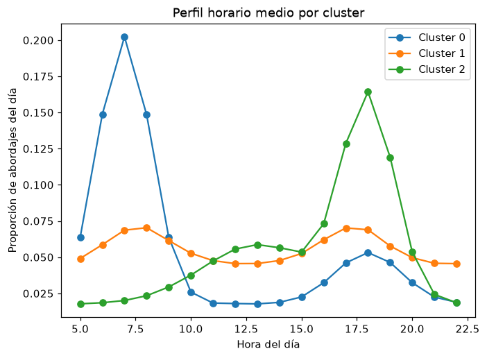
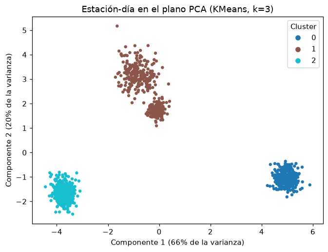

# Informe de pruebas

**Proyecto:** Agrupamiento de estaciones de TransMilenio (Bogotá) por perfil de demanda
**Curso:** Inteligencia Artificial, Corporación Universitaria Iberoamericana
**Actividad:** 4 - Métodos de aprendizaje no supervisado

## 1. Objetivo

Verificar que el generador de datos y el agrupamiento se comportan como se documenta, y reportar con evidencia real los resultados del modelo no supervisado. Todas las salidas de este informe se obtuvieron ejecutando el código del repositorio con semilla 42.

## 2. Entorno

| Elemento | Valor |
|---|---|
| Sistema operativo | macOS (Darwin) |
| Python | 3.14.7 |
| pytest | 9.1.1 |
| Bibliotecas | pandas, scikit-learn, matplotlib, pytest (`requirements.txt`) |

## 3. Resultados de `python -m pytest -v`

**Total: 11 pruebas, 11 aprobadas, 0 fallidas (2.29 s).**

```text
$ .venv/bin/python -m pytest -v
tests/test_cluster.py::test_features_have_no_nan_and_expected_width PASSED [  9%]
tests/test_cluster.py::test_hourly_shares_sum_to_one PASSED              [ 18%]
tests/test_cluster.py::test_choose_k_returns_k_in_range PASSED           [ 27%]
tests/test_cluster.py::test_kmeans_beats_random_labels_on_silhouette PASSED [ 36%]
tests/test_cluster.py::test_kmeans_recovers_hidden_archetypes PASSED     [ 45%]
tests/test_cluster.py::test_hierarchical_agrees_with_kmeans PASSED       [ 54%]
tests/test_dataset.py::test_shape_and_columns PASSED                     [ 63%]
tests/test_dataset.py::test_no_nulls_and_valid_values PASSED             [ 72%]
tests/test_dataset.py::test_all_network_stations_have_an_archetype PASSED [ 81%]
tests/test_dataset.py::test_seed_reproducibility PASSED                  [ 90%]
tests/test_dataset.py::test_archetype_is_not_leaked_into_the_data PASSED [100%]

============================== 11 passed in 2.29s ==============================
```

### Qué verifica cada prueba

| Módulo | Prueba | Qué verifica |
|---|---|---|
| `test_dataset.py` | `test_shape_and_columns` | 1200 filas (20 estaciones × 60 días) y columnas exactas: `station`, `day_type`, `rain`, `h05`..`h22` |
| | `test_no_nulls_and_valid_values` | Sin nulos; `day_type` y `rain` con valores válidos; conteos no negativos y enteros |
| | `test_all_network_stations_have_an_archetype` | Cada estación de `network.json` tiene arquetipo asignado y viceversa |
| | `test_seed_reproducibility` | La misma semilla produce un DataFrame idéntico; una semilla distinta, datos distintos |
| | `test_archetype_is_not_leaked_into_the_data` | El arquetipo oculto no aparece como columna del CSV |
| `test_cluster.py` | `test_features_have_no_nan_and_expected_width` | La matriz de variables no tiene NaN y tiene 19 columnas (18 proporciones + volumen) |
| | `test_hourly_shares_sum_to_one` | Las proporciones horarias de cada fila suman 1 |
| | `test_choose_k_returns_k_in_range` | `choose_k` devuelve un k del rango 2..8 con la mayor silueta |
| | `test_kmeans_beats_random_labels_on_silhouette` | La silueta de KMeans supera en más de 0.1 a la de etiquetas aleatorias |
| | `test_kmeans_recovers_hidden_archetypes` | El índice de Rand ajustado contra el arquetipo oculto es mayor que 0.6 |
| | `test_hierarchical_agrees_with_kmeans` | El agrupamiento jerárquico (Ward) coincide con KMeans (ARI mayor que 0.6) |

Las pruebas usan las funciones reales, sin simulaciones (mocks).

## 4. Resultados de `python -m src.dataset`

```text
$ .venv/bin/python -m src.dataset
Wrote 1200 rows x 21 columns to data/station_profiles.csv
day_type
weekday           0.601
saturday          0.208
sunday_holiday    0.191
rain share: 0.243
count    1200.0
mean     2010.8
std      1403.4
min       342.0
25%      1055.5
50%      1777.5
75%      2237.2
max      7874.0
```

## 5. Resultados de `python -m src.cluster`

Salida real:

```text
$ .venv/bin/python -m src.cluster
Rows: 1200 | features: 19
Silhouette by k (KMeans):
  k=2: 0.562
  k=3: 0.640  <- chosen
  k=4: 0.607
  k=5: 0.569
  k=6: 0.397
  k=7: 0.236
  k=8: 0.232

ARI KMeans vs hierarchical:        1.000
ARI KMeans vs hidden archetype:    0.859  (validation only)
ARI hierarchical vs archetype:     0.859  (validation only)

Cluster 0: 360 station-days | mean total 1687
  day types: {'weekday': 0.59, 'saturday': 0.22, 'sunday_holiday': 0.19}
  top stations: {'Portal Eldorado': 60, 'Modelia': 60, 'Normandía': 60, 'Portal Américas': 60, 'Banderas': 60}

Cluster 1: 420 station-days | mean total 2532
  day types: {'weekday': 0.59, 'saturday': 0.21, 'sunday_holiday': 0.2}
  top stations: {'Calle 26': 60, 'Av. Rojas': 60, 'Corferias': 60, 'Concejo de Bogotá': 60, 'Centro Memoria': 60}

Cluster 2: 420 station-days | mean total 1766
  day types: {'weekday': 0.62, 'saturday': 0.2, 'sunday_holiday': 0.18}
  top stations: {'Calle 100': 60, 'Héroes': 60, 'Calle 72': 60, 'Calle 63': 60, 'Calle 45': 60}

Plots saved to docs/img
```

## 6. Interpretación de los resultados

### 6.1 Elección de k

| k | Silueta (KMeans) |
|---|---|
| 2 | 0.562 |
| **3** | **0.640** |
| 4 | 0.607 |
| 5 | 0.569 |
| 6 | 0.397 |
| 7 | 0.236 |
| 8 | 0.232 |

La silueta máxima está en k = 3 (0.640). Un valor cercano a 1 indica grupos compactos y bien separados; por encima de 0.6 se considera una estructura clara. A partir de k = 6 la silueta cae con fuerza, señal de que se está partiendo grupos que ya eran compactos.

### 6.2 Grupos encontrados

| Cluster | Estación-días | Volumen diario medio | Perfil horario | Estaciones |
|---|---|---|---|---|
| 0 | 360 | 1687 | Pico marcado en la mañana (7 h, cerca del 20 % de los abordajes del día) | Portal Eldorado, Portal Américas, Banderas, Marsella, Modelia, Normandía |
| 1 | 420 | 2532 | Perfil plano con picos suaves en la mañana (8 h) y la tarde (17-18 h) | Calle 26, Centro Memoria, Ricaurte, Av. Rojas, Corferias, Concejo de Bogotá, Puente Aranda |
| 2 | 420 | 1766 | Pico marcado en la tarde (18 h, cerca del 16 % de los abordajes) y meseta al mediodía | Calle 100, Calle 72, Calle 63, Calle 45, Calle 34, Héroes, Calle 75 |

Lectura: el cluster 0 corresponde a estaciones de origen residencial (los pasajeros salen en la mañana), el cluster 2 a estaciones de destino laboral (los pasajeros regresan en la tarde) y el cluster 1 a estaciones con demanda repartida durante el día. La proporción de tipos de día es parecida en los tres grupos (aproximadamente 60 % día hábil, 20 % sábado, 20 % domingo o festivo), lo que confirma que el agrupamiento separa tipos de estación y no tipos de día.





El plano PCA explica 66 % y 20 % de la varianza (86 % en total). Los clusters 0 y 2 forman nubes compactas y bien separadas; el cluster 1 muestra dos subnubes visibles, que corresponden a los arquetipos `hub` y `mixed` (ver sección 6.4).

### 6.3 Validación externa

| Comparación | ARI |
|---|---|
| KMeans frente a jerárquico (Ward) | 1.000 |
| KMeans frente a arquetipo oculto | 0.859 |
| Jerárquico frente a arquetipo oculto | 0.859 |

El arquetipo oculto **no se usa para ajustar** los modelos; solo se compara al final. Los dos algoritmos producen la misma partición (ARI 1.000), lo que indica que la estructura de los datos es robusta frente al método de agrupamiento.

### 6.4 Hallazgo: `hub` y `mixed` quedan fusionados

El generador define cuatro arquetipos, pero el criterio de silueta elige k = 3. La tabla cruzada entre el arquetipo oculto y el cluster asignado por KMeans es:

| Arquetipo | Cluster 0 | Cluster 1 | Cluster 2 |
|---|---|---|---|
| `residential` | 360 | 0 | 0 |
| `business` | 0 | 0 | 420 |
| `hub` | 0 | 180 | 0 |
| `mixed` | 0 | 240 | 0 |

`hub` (3 estaciones, 180 filas) y `mixed` (4 estaciones, 240 filas) caen juntos en el cluster 1. Tienen casi la misma forma horaria (plana, con picos suaves) y se distinguen sobre todo por el volumen. Por eso el ARI frente al arquetipo es 0.859 y no 1.0: no hay estaciones mal asignadas, sino dos arquetipos tratados como uno.

La silueta con k = 4 (0.607) es cercana a la de k = 3 (0.640), y el plano PCA ya muestra las dos subnubes. Es decir, el resultado k = 3 es una elección válida según el criterio, pero no agota la estructura de los datos. Una fase posterior revisa el generador para separar ambos arquetipos.

## 7. Limitaciones

- **Datos sintéticos.** Los grupos son los arquetipos escritos en `src/dataset.py` más ruido. El resultado ilustra el método, no es una afirmación sobre el comportamiento real de TransMilenio.
- **Fusión de `hub` y `mixed`.** El criterio de silueta elige k = 3 y agrupa dos arquetipos con forma parecida (sección 6.4).
- **Una sola configuración.** Los resultados corresponden a una semilla (42) y a 60 días por estación; con otra semilla se esperan diferencias pequeñas en las siluetas.
- **Validación externa disponible solo por ser sintéticos.** Con datos reales no existiría un arquetipo de referencia y solo se podría usar la silueta y la interpretación de los perfiles.

## 8. Reproducibilidad

Toda la aleatoriedad usa la semilla 42 (`SEED` en `src/dataset.py` y `src/cluster.py`). Ejecutar de nuevo `python -m src.dataset` y `python -m src.cluster` produce el mismo archivo y las mismas métricas. Las instrucciones están en `docs/INSTRUCCIONES.md`.
